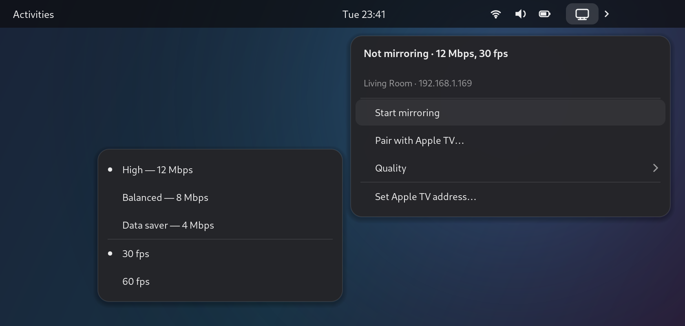
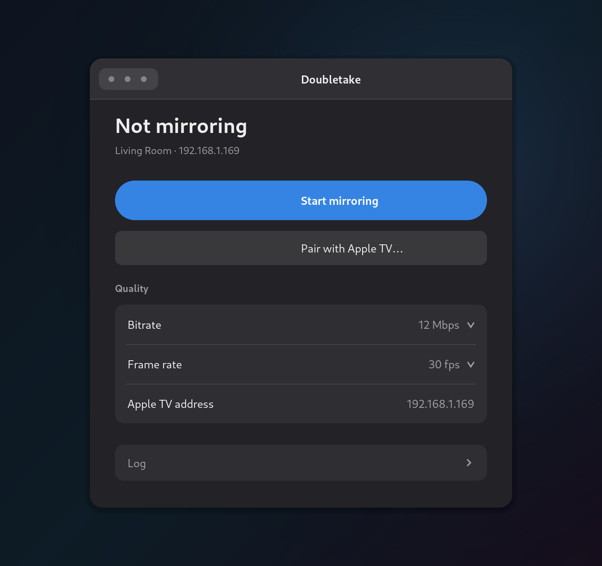

# Mirror a Linux desktop to an Apple TV over AirPlay

**AirPlay screen mirroring from Linux to an Apple TV** — a GNOME top bar
indicator and a small desktop app, built on
[doubletake](https://github.com/omarroth/doubletake), the AirPlay *sender* for
Linux. Cast your Fedora / GNOME (Wayland) desktop to an Apple TV 4K or HD the way
a Mac would: whole screen, with audio, no cable and no dongle.

[](LICENSE)
[](#requirements)
[](#faq)

<p align="center">
  
</p>

<p align="center"><em>UI illustration — the real menu is drawn by GNOME and follows your theme.</em></p>

## What this adds

Upstream `doubletake` is a CLI. This project wraps it for desktop use on Fedora:

| Piece | What it does |
|---|---|
| **Top bar indicator** | Start/stop mirroring, pair, pick bitrate and frame rate, see errors — all from the GNOME panel. Icon turns into a red record dot while streaming. |
| **Desktop app** | GTK4/libadwaita window with the same controls plus a live log, for use before the extension is loaded (or instead of it). |
| **Installer** | Builds doubletake from pinned upstream source, applies one patch, installs everything into `~/.local` — no root. |
| **Capture-path patch** | Works around a Wayland capture bug that kills the stream ~2 s in on some AMD/Mesa + GStreamer combinations (details in [patches/README.md](patches/README.md)). |
| **Shared settings** | One JSON file (`~/.config/doubletake/shell.json`) drives both the indicator and the app. |
| **Sane defaults** | 12 Mbps instead of the auto-picked ~4.1 Mbps, which is what makes desktop text look sharp on a TV. |

Nothing is installed system-wide, no root, no daemon, no background service.

## Requirements

- Fedora with GNOME on **Wayland** (developed against Fedora 44 / GNOME 50, GStreamer 1.28)
- An Apple TV (or AirPlay-2-capable TV) on the same network — verified against an
  Apple TV 4K, 3rd gen (`AppleTV14,1`, tvOS 27)
- GStreamer + `pactl`:

```sh
sudo dnf install gstreamer1-plugins-base gstreamer1-plugins-good \
                 gstreamer1-plugins-bad-free gstreamer1-plugins-ugly-free \
                 gstreamer1-plugin-libav gstreamer1-plugin-openh264 \
                 pulseaudio-utils
```

- `zenity` for the PIN dialog: `sudo dnf install zenity`
- Go is **only** needed to build; the installer downloads a toolchain into
  `~/.local/go-toolchain` if you don't have one.

Verify the encoder and capture elements exist:

```sh
gst-inspect-1.0 openh264enc >/dev/null && echo ok
gst-inspect-1.0 pipewiresrc  >/dev/null && echo ok
```

## Install

```sh
git clone https://github.com/martintondel02/doubletake-airplay.git
cd doubletake-airplay
./install.sh
```

The installer prints every step and stops with an explanation if a dependency is
missing. Options:

```
--no-gui          skip the GTK4 app
--no-extension    skip the top bar indicator
--skip-build      reuse the previous ./.build (offline re-install)
```

Then **log out and back in once**. GNOME only scans for new Shell extensions at
session start, so the top bar icon appears after the next login. Until then use
`doubletake-gui`.

> [!IMPORTANT]
> Locking the screen, suspending, or toggling the extension in the Extensions app
> does **not** load it — the running Shell has to be restarted. On Wayland that
> means a real log out and log in (`gnome-session-quit --logout`); there is no
> `Alt`+`F2` `r` shortcut any more. Verify with
> `gnome-extensions info doubletake@local`.
>
> The Extensions app may list the extension *before* this, because it reads the
> folder on disk while the Shell reads its own loaded list — that mismatch is the
> most common "it's installed but there is no icon" report.

## Pairing (one time)

AirPlay pairing shows a 4-digit PIN on the TV:

- **Top bar / app:** *Pair with Apple TV…* → the TV shows a PIN → type it in the dialog.
- **CLI:**

```sh
doubletake -target 192.168.1.169 -pair
```

Credentials are stored in `~/.config/doubletake/credentials.json`; you only do
this once per TV. If "Require Password" is enabled on the Apple TV, pass that
password instead (`DOUBLETAKE_CODE=… doubletake -target …`).

Not sure of the address?

```sh
avahi-browse -rtp _airplay._tcp | grep '=;'
```

## Usage

### Top bar

Click the icon → *Start mirroring*. First run pops a GNOME "Share your screen"
dialog; pick the monitor. The choice is remembered, so later runs start silently.

### Desktop app

Launch **Doubletake** from the app grid, or:

```sh
doubletake-gui
```

<p align="center">
  
</p>

### Command line

`~/.local/bin/doubletake` is a wrapper around the real binary in
`~/.local/libexec/doubletake/`. It adds two defaults (see *Quality* below) and
takes all of upstream's flags:

```sh
doubletake -target 192.168.1.169                # mirror at 12 Mbps, 30 fps
doubletake -target 192.168.1.169 -fps 60        # smoother, ~1 CPU core
doubletake -target 192.168.1.169 -bitrate 4000  # weak Wi-Fi
doubletake -target 192.168.1.169 -no-audio      # video only
doubletake -target 192.168.1.169 -debug         # verbose protocol log
```

Useful extras from upstream: `-no-cursor`, `-port-range MIN-MAX` (firewalls),
`-daemonize` + `doubletake-ctl` (multi-TV control), `-test` (synthetic video).

## Quality

The wrapper defaults to **12 Mbps** because upstream's auto formula picks
`width × height × fps ÷ 15000` ≈ 4.1 Mbps for 1080p30, which is conservative for
desktop text. Measured on a ThinkPad T14 (Radeon 840M, software OpenH264):
bitrate costs almost no CPU — the 1080p30 encode dominates either way.

| Setting | CPU (one core) | Notes |
|---|---|---|
| 4 Mbps | ~80 % | upstream default |
| 12 Mbps | ~85 % | wrapper default |
| 12 Mbps @ 60 fps | ~100 % | smooth scrolling |

Override with `DOUBLETAKE_BITRATE=8000 doubletake …` or the `-bitrate` flag.

**Sharpness ceiling:** the capture size is your *logical* resolution. On a
1920×1200 panel at 125 % scaling that is 1536×960, upscaled to the TV's 1080p
canvas. For maximum crispness set the display to 100 % scaling — at the cost of
a smaller UI.

## How it works

```
top bar (extension.js) ─┐
                        ├─ spawn ─→ ~/.local/bin/doubletake ─→ ~/.local/libexec/doubletake/doubletake
desktop app (python)  ──┘            (wrapper: env defaults)         │
                                                                     ├─ xdg-desktop-portal → PipeWire screen capture
                                                                     └─ GStreamer → H.264 → AirPlay to the Apple TV
```

Both front ends spawn the CLI and parse its log lines (`mirror session ready`,
`streaming error`, …) to drive their state, and share
`~/.config/doubletake/shell.json`:

```json
{ "target": "192.168.1.169", "name": "Living Room", "bitrate": 12000, "fps": 30 }
```

Don't start a stream from both front ends at once — each owns its own
`doubletake` process.

## FAQ

### Does AirPlay work on Linux?

Yes, in both directions, with different tools:

- **Sending (Linux → Apple TV)** — what this project does. `doubletake`
  implements the AirPlay 2 mirroring sender: FairPlay, SRP pairing, H.264/HEVC,
  encrypted video. Point it at an Apple TV and your desktop appears there.
- **Receiving (iPhone/Mac → Linux)** — [UxPlay](https://github.com/FDH2/UxPlay)
  or [shairport-sync](https://github.com/mikebrady/shairport-sync) make a Linux
  box pretend to be an Apple TV.

### How do I cast or mirror from Linux to an Apple TV?

Three commands, once per TV:

```sh
./install.sh                                    # build + install
avahi-browse -rtp _airplay._tcp | grep '=;'     # find the TV
doubletake -target 192.168.1.169 -pair          # enter the PIN shown on screen
```

After that it is one click in the top bar, one button in the app, or
`doubletake -target <ip>`.

### Can I mirror the whole screen, or only videos?

The whole desktop, like AirPlay Mirroring on macOS — every window, the pointer,
and system audio. It is screen *mirroring*, not the "cast this one video" AirPlay
mode that players like VLC use.

### What about audio?

Screen audio goes out as ALAC via PipeWire/PulseAudio. If the receiver refuses
the advertised format, `-no-audio` keeps video running.

### Which Linux distributions and desktops work?

The capture path is **Wayland with `xdg-desktop-portal`** (GNOME, KDE, and other
compositors) or **X11**. This repo's installer, top bar indicator and guides are
written and tested for **Fedora + GNOME** (`doubletake` itself is distro-agnostic;
the AUR packages cover Arch).

### Is this an AirPlay receiver?

No. It does not turn your laptop into an Apple TV — it turns your laptop into a
*sender*. Use UxPlay if you want the other direction.

### Why do I need `doubletake` as well?

Because it is the hard part: the AirPlay 2 protocol, FairPlay key exchange and the
GStreamer capture/encode pipeline. This repo adds the desktop layer — installer,
settings, top bar UI, app — and one patch for a capture bug on AMD/Mesa.

### Can I use it without GNOME?

Yes: `doubletake` is a normal CLI, and the GTK4 app works on any desktop with
`libadwaita`. Only the top bar indicator is GNOME-specific.

## Troubleshooting

See [docs/TROUBLESHOOTING.md](docs/TROUBLESHOOTING.md). The two classics:

```sh
# stream dies after ~2 s
grep "streaming error" <(doubletake -target <ip> -debug 2>&1)   # → see the patch notes
# top bar icon missing after login
journalctl --user -b | grep -i -E "doubletake|JS ERROR"
```

## Uninstall

```sh
./uninstall.sh
```

Settings and pairing credentials stay in `~/.config/doubletake`; delete it to
forget the TV. Log out and back in to drop the icon from the running session.

## License

MIT for this repository's own code (indicator, app, scripts). The patch in
`patches/` modifies [doubletake](https://github.com/omarroth/doubletake), which
is **LGPL-3.0-or-later**, so that patch is LGPL-3.0-or-later as well. No part of
doubletake is redistributed here — the installer builds it from upstream source.

## Credits and related projects

- [omarroth/doubletake](https://github.com/omarroth/doubletake) — the actual
  AirPlay sender (FairPlay, SRP pairing, H.264/HEVC pipeline)
- [UxPlay](https://github.com/FDH2/UxPlay) — AirPlay *receiver* for Linux
- [shairport-sync](https://github.com/mikebrady/shairport-sync) — AirPlay audio
  receiver
- [pyatv](https://github.com/postlund/pyatv) — control Apple TV / AirPlay devices
  from Python (`atvremote`)
- [GNOME Shell](https://gitlab.gnome.org/GNOME/gnome-shell) and libadwaita

Search terms this project is meant to answer: *airplay linux*, *airplay 2 linux*,
*mirror linux to apple tv*, *cast linux screen to apple tv*, *airplay sender
linux*, *screen mirroring apple tv from fedora*, *gnome airplay*, *wayland screen
mirroring to apple tv*.
